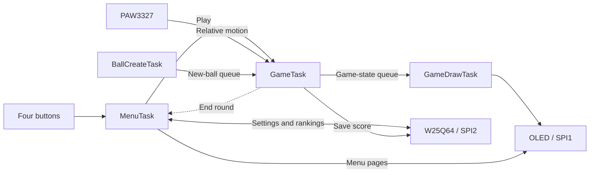

  

<h1 align="center">OptiDodge</h1>

<strong>Slide the device. Dodge the incoming balls.</strong>

STM32F103C8T6 · FreeRTOS · PAW3327 · Monochrome OLED

<strong>English</strong> · <a href="README_ZH.md">简体中文</a>

## Overview

OptiDodge is a tabletop bullet-dodging game built on an STM32 microcontroller. Sliding the device across a surface moves a cross-shaped player on a 128 × 64 OLED. Circular obstacles enter from the screen edges; the player avoids them to keep increasing the score.

The project brings together optical motion sensing, embedded graphics, FreeRTOS task coordination and Flash storage, with a custom PCB and a 3D-printed base.

*Gameplay preview reconstructed from the current drawing and OLED functions, including page/column addressing and the SH1106 panel mapping documented in the supplied datasheets. Positions and score are illustrative; this is a completed-frame simulation, not a device capture.*

## Gameplay and controls

- **Play:** start a game and move the device to dodge incoming balls. A collision ends the round and adds the result to the score-recording flow.
- **Ranking:** browse scores in descending order, with storage for up to 100 records.
- **Setting:** adjust ball size and movement sensitivity, restore defaults or clear scores.
- **Game Over:** show the end-of-round message, then return to the main menu.

Four buttons navigate the interface:

| Input | Action |
|---|---|
| Move the device | Move the player during a game |
| Up / Down | Select menu items or change ranking pages |
| Right | Confirm a selection, increase a value or execute an action |
| Left | Decrease a value; return from the ranking page |

In Settings, moving past the first or last item returns to the main menu. The DPI setting controls software movement sensitivity; the sensor is initialized at a fixed 1500 CPI. A difficulty item is present in the menu, but its value is not yet connected to spawning or speed rules.

*Illustrative menu states reconstructed from the source. Values and scores shown are examples, not current defaults or device captures.*

## Architecture

The firmware separates game state updates from drawing. The game task reads the sensor, updates positions and checks collisions; the drawing task receives a copy of the game state and renders it.

| Task | Responsibility |
|---|---|
| InitTask | Load settings, create queues and the event group, start the menu, then delete itself |
| MenuTask | Handle menu navigation, settings and rankings; create the game tasks when Play is selected |
| GameTask | Read optical motion, apply sensitivity scaling, update balls and the player, detect collisions and update the score |
| BallCreateTask | Generate balls using a single-shot timer with randomized periods, then send them to the game task |
| GameDrawTask | Compose the player and balls into a framebuffer, update the OLED and display Game Over |

The five task functions do not all run throughout a round: the menu hands control to the game tasks, and is recreated after the round ends. Menu pages are drawn by MenuTask; gameplay is drawn by GameDrawTask. Event-group bits coordinate the game tasks' exit.

The game timer requests an update every **40 ms**. Graphics use a **1024-byte, 1-bit framebuffer**, Bresenham circle drawing and a pool of up to **20 balls**. Collision detection checks relative movement over a frame, including the start, end and closest approach.

## Technology stack

| Layer | Technologies |
|---|---|
| MCU | STM32F103C8T6, Arm Cortex-M3, 64 KiB Flash / 20 KiB SRAM |
| Firmware | C, STM32 HAL, CMSIS |
| Scheduling | FreeRTOS V10.5.1, tasks, queues, task notifications, software timers and event groups |
| Display | 128 × 64 monochrome OLED, bitmap composition and 6 × 8 / 8 × 16 fonts |
| Input | PAW3327 optical motion sensor and four tactile buttons |
| Storage | W25Q64 SPI NOR Flash; settings and score records |
| Development | Keil MDK-ARM / ARM Compiler 5, STM32CubeMX, ST-Link / SWD |
| Hardware design | EasyEDA Pro PCB design, SolidWorks base design and STL for 3D printing |

The current clock configuration uses an **8 MHz HSE × 9 PLL** for a **72 MHz** system clock. SPI1 and SPI2 are configured for **Mode 3 at approximately 1.125 MHz**. The OLED uses SPI1; the sensor and Flash share SPI2 with separate chip selects.

## Hardware and materials

The table combines the project's PCB BOM with the purchased component specifications. Quantities below describe a single device where established; bulk purchase pack sizes are not assembly quantities.

### Main components

| Component | Specification | Quantity | Purpose |
|---|---|---:|---|
| MCU board | LCKFB-DKX-STM32F103C8T6 | 1 | Main controller |
| Optical sensor kit | PAW3327DB-TWQU, DIP-8, with lens and illumination LED | 1 set | Detect movement over the surface |
| OLED module | 1.3-inch, 128 × 64, white monochrome, six-pin SPI | 1 | Display menus and gameplay |
| Flash chip | W25Q64JVSSIQ, SOP-8, 64 Mbit / 8 MiB | 1 | Store settings and scores |
| Power supply | 5 V / 3.3 V module with a 14500 Li-ion battery | 1 set | Power the assembled device |
| Tactile switches | TS-1088-AR02016, approximately 4 × 3 mm | 4 | Menu input |

The sensor kit already includes its lens and illumination LED. The PCB BOM names HSDL-4261 for the illumination position; check the supplied LED against the assembly footprint. The purchase selection is W25Q64JVSSIQ, while the design BOM names W25Q64JVSSIM.

### Passives and assembly parts

| Part | Specification | Quantity / assembly note |
|---|---|---|
| Resistors | 0603, 10 kΩ, 1% | 4 |
| Resistor | 0603, 33 Ω, 1% | 1 |
| Capacitors | 0603, 100 nF, ±10%, 50 V | 3 |
| Capacitors | 0603, 10 µF, ±10%, 10 V | 2 |
| Indicator LED | 0603; GL0603UR01 in the PCB BOM | 1 |
| Female headers | 6-pin single row, 20-pin single row, 2 × 2 double row | Fit to the OLED, MCU board and power connections |
| Screws | M3 × 3, stainless steel | According to the mounting holes |
| Standoffs | M3 × 4, female-to-female hex brass | According to the mounting holes |
| Mouse feet | PTFE dots, 6.5 mm diameter, 0.8 mm thick | Place on the base to support smooth sliding |

The custom PCB and printed base are additional fabricated parts. Header and mounting-part quantities depend on the actual assembly. The MCU board and indicator LED are listed from the design BOM; the remaining specifications are supplemented by the purchase records.

### Connections

| Peripheral | STM32 signals |
|---|---|
| OLED / SPI1 | SCK PA5, MOSI PA7, RST PA2, D/C PA3 |
| Shared SPI2 | SCK PB13, MISO PB14, MOSI PB15 |
| PAW3327 | NCS PA8, MOTION PA10 |
| W25Q64 | NCS PA9 |
| Buttons | KEY1–KEY4: PB3, PB4, PB5, PB6 |
| SWD | SWDIO PA13, SWCLK PA14 |

The six-pin OLED has no exposed CS pin. The sensor is polled by GameTask; MOTION is available on the PCB but is not the current game input trigger. See the [pin assignment table](OptiDodge_pin.csv) for the project mapping.

## Source and design files

| Location | Contents |
|---|---|
| [Core](OptiDodge/Core) | Startup application, clocks, GPIO and interrupt handling |
| [Hardware](OptiDodge/Hardware) | OLED, PAW3327, W25Q64 and button drivers |
| [Interface](OptiDodge/Interface) | Main menu, settings and ranking pages |
| [System](OptiDodge/System) | Game logic, graphics, storage modules and RTOS tasks |
| [FreeRTOS](OptiDodge/FreeRTOS) | RTOS kernel and port |
| [Keil project](OptiDodge/MDK-ARM/OptiDodge.uvprojx) · [CubeMX configuration](OptiDodge/OptiDodge.ioc) | Firmware project configuration |
| [PCB project](<PCB%20And%20Shell/OptiDodge_PCB/Ball_Gaming_PCB.eprj3>) · [PCB BOM](<PCB%20And%20Shell/OptiDodge_PCB/BOM_Board1_PCB1_2026-10-20.xlsx>) | Board design and component list |
| [SolidWorks model](<PCB%20And%20Shell/OptiDodge.SLDPRT>) · [STL](<PCB%20And%20Shell/OptiDodge.STL>) | Base / enclosure design |

This is an evolving educational project. Third-party drivers and libraries retain their original author and license notices.

---

[阅读简体中文版 →](README_ZH.md)
