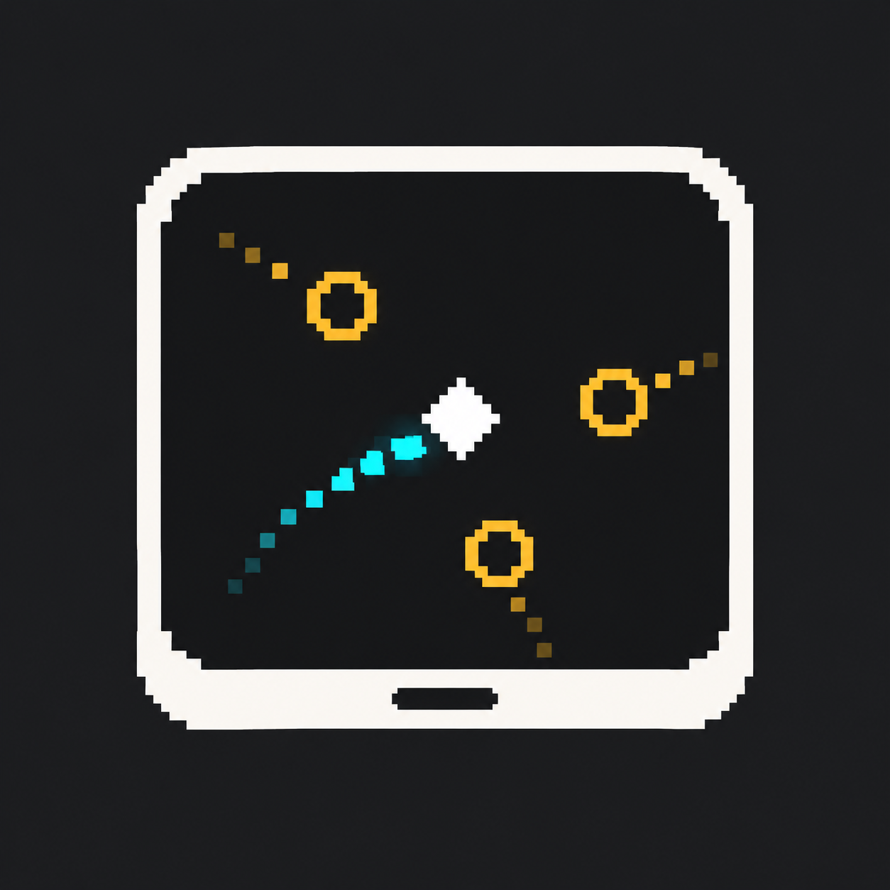
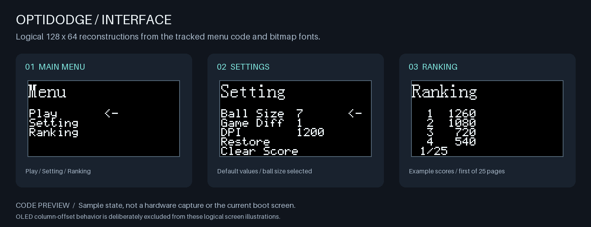
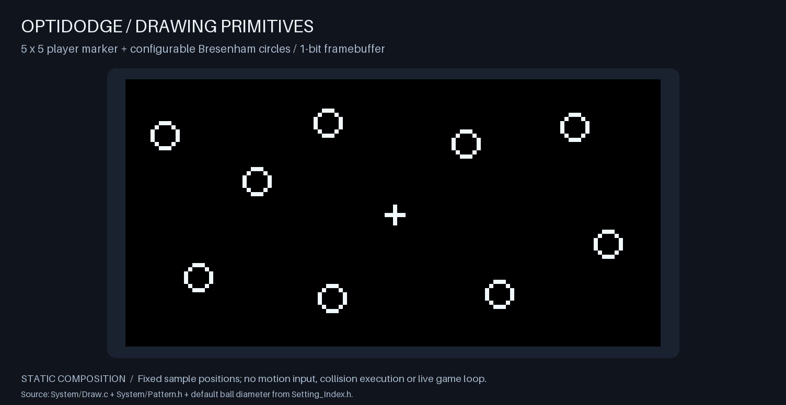
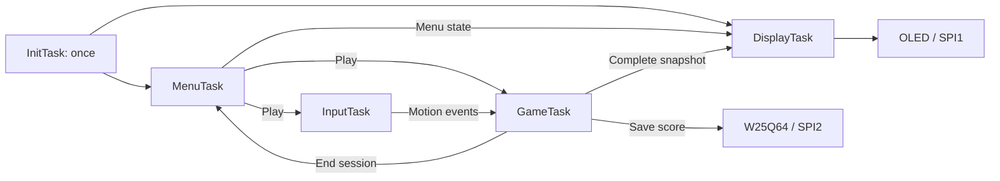

<p align="center">
  
</p>

<h1 align="center">OptiDodge</h1>

<p align="center"><strong>Slide the device. Dodge the bullets. Build the system.</strong></p>
<p align="center">STM32F103C8T6 · 128 × 64 monochrome OLED · PAW3327 optical motion · W25Q64 · FreeRTOS</p>
<p align="center"><strong>English</strong> · <a href="README_ZH.md">简体中文</a></p>

> **Development snapshot — 2026-10-28:** hardware bring-up and application modules are available; the complete RTOS game is still being integrated. The current firmware boots into a **W25Q64 JEDEC-ID diagnostic**, not a playable game or the menu shown below.



*These illustrations reconstruct the tracked menu code and bitmap fonts in logical 128 × 64 pixel space. Settings and scores are sample state; these are not device captures. Controller-specific column offsets are not simulated.*

**Explore:** [Current status](#current-status) · [Hardware](#hardware) · [Build and run](#build-and-run) · [Controls](#controls-and-menu-modules) · [Architecture](#architecture) · [Roadmap](#roadmap)

## What is OptiDodge?

OptiDodge is an embedded bullet-dodging game project built around a small monochrome display. Its intended interaction is **desktop translation**: sliding the device lets a PAW3327 optical sensor measure relative motion, which will move the player through incoming circular obstacles. Four buttons provide menu navigation and configuration.

The repository combines STM32 HAL firmware, graphics and game algorithms, persistent-score/settings modules, a FreeRTOS integration scaffold, and PCB/enclosure design files. The implementation is deliberately incremental: validate the display and storage first, then connect input, game state, rendering and task scheduling.

## Current status

The distinction between **implemented modules**, **the active boot path**, and **planned integration** matters:

| Area | Present in the repository | Current integration status |
|---|---|---|
| OLED | Blocking HAL SPI driver, initialization, clear, text, numbers, bitmap output, selectable fonts | Used by the active diagnostic firmware; display operation has been exercised on hardware |
| Graphics | 5 × 5 player marker, configurable circle generation, page-format framebuffer composition | Drawing primitives implemented; not yet a running game renderer |
| Menu | Main menu, settings, ranking, selection arrows and paging | Module code available; commit `431931f` records PCB menu testing; current `main()` does not run this menu |
| W25Q64 | JEDEC ID, reads, write-enable, page program, sector erase and busy polling | ID reads are the current boot demo; transport/error handling still needs hardening |
| Scores | Up to 100 scores, descending heap sort, binary-search insertion, load/save/clear APIs | Module-level implementation; record-format validation remains necessary |
| Settings | Ball size, difficulty, DPI selection, defaults and Flash APIs | RAM/settings APIs implemented; selecting DPI does not yet program the optical sensor |
| Game logic | Player/ball structures, four-edge spawning, integer velocities and relative-motion collision prototype | No complete movement/update/game-over loop is connected to `main()` |
| Optical input | PAW3327 chip-select and MOTION pins allocated | No PAW3327 register/position-reading driver is tracked yet |
| FreeRTOS | V10.5.1 kernel, Cortex-M3 RVDS port, `heap_4`, `RTOS_Init()` and `InitTask()` scaffold | `main()` does not call `RTOS_Init()`; `InitTask()` currently creates no application tasks |
| Hardware design | Schematic, PCB, BOM, enclosure CAD and STL | Design sources are included; verify the selected revision against the physical assembly |

## Hardware

### Platform and current bus configuration

| Item | Configuration |
|---|---|
| MCU | STM32F103C8T6 / Cortex-M3; target memory map: 64 KiB Flash, 20 KiB SRAM |
| Firmware clock | **8 MHz HSI, no PLL** in the current `SystemClock_Config()`; the MCU's 72 MHz capability is not the current runtime clock |
| OLED | 128 × 64 monochrome, six-pin serial module; VCC/GND/SCL/SDA/RST/D/C |
| SPI1 / OLED | Master, 8-bit, MSB first, **Mode 3**, prescaler 8 → approximately **1 MHz** with the current clock |
| SPI2 / storage and planned sensor | Master, 8-bit, MSB first, **Mode 0**, prescaler 2 → approximately **4 MHz** |
| HAL time base | TIM2 supplies the HAL tick; SysTick is reserved for the FreeRTOS integration |
| Download/debug | SWD remains enabled; JTAG is disabled to release button pins |

Use the active GPIO definitions in [main.h](OptiDodge/Core/Inc/main.h), SPI setup in [main.c](OptiDodge/Core/Src/main.c), and the tracked [pin assignment table](OptiDodge_pin.csv). The historical wiring comments at the top of the vendor OLED files are not the active pin mapping.

### Signal mapping

| Connection | STM32 pin | Notes |
|---|---|---|
| OLED SCL / SCK | PA5 | SPI1 clock |
| OLED SDA / DIN | PA7 | SPI1 MOSI |
| OLED RST | PA2 | Software-controlled panel reset |
| OLED D/C | PA3 | Command/data selection |
| OLED VCC / GND | 3.3 V / common ground | Matches the display used during bring-up |
| Shared SPI2 SCK | PB13 | W25Q64; optical-input bus allocation |
| Shared SPI2 MISO | PB14 | MCU receive |
| Shared SPI2 MOSI | PB15 | MCU transmit |
| W25Q64 NCS | PA9 | Active-low chip select |
| PAW3327 NCS | PA8 | Allocated; sensor driver pending |
| PAW3327 MOTION | PA10 | Currently configured as a GPIO input; no EXTI handler is implemented |
| KEY1 / KEY2 / KEY3 / KEY4 | PB3 / PB4 / PB5 / PB6 | Pull-up inputs, active low |
| SWDIO / SWCLK | PA13 / PA14 | Preserve for programming and debugging |

The six-pin OLED exposes no CS pin; its CS macros are empty in this port. SPI1 is dedicated to the display. SPI2 is shared by the Flash and the planned sensor: their chip selects start high, and `W25Q64_Enable()` deselects the sensor before selecting the Flash. Sensor power and wiring must follow the actual PCB revision rather than treating this logical pin table as a bare-chip electrical specification.

Hardware files:

- [EasyEDA Pro project](<PCB%20And%20Shell/OptiDodge_PCB/Ball_Gaming_PCB.eprj3>), [schematic](<PCB%20And%20Shell/OptiDodge_PCB/sch/Schematic1/P1.esch2>) and [PCB](<PCB%20And%20Shell/OptiDodge_PCB/pcb/PCB1.epcb2>).
- [BOM](<PCB%20And%20Shell/OptiDodge_PCB/BOM_Board1_PCB1_2026-10-20.xlsx>).
- [Enclosure STL](<PCB%20And%20Shell/OptiDodge.STL>) and [SolidWorks source](<PCB%20And%20Shell/OptiDodge.SLDPRT>).
- [Folder-based EasyEDA project notes](<PCB%20And%20Shell/OptiDodge_PCB/eprj3-intro.md>).

## Build and run

### Primary development environment

- Keil MDK-ARM / µVision; the project selects **ARM Compiler 5.06 update 5, build 528**.
- Target: **OptiDodge**, device: **STM32F103C8**.
- The project records device pack **Keil.STM32F1xx_DFP.2.2.0**. The tracked CubeMX configuration records **STM32Cube FW_F1 V1.8.7**.
- [Keil project](OptiDodge/MDK-ARM/OptiDodge.uvprojx) and [CubeMX configuration](OptiDodge/OptiDodge.ioc).

**Fresh-checkout limitation:** the checked-in Keil project refers to an ARMASM startup item supplied by the local generated/device-support environment, rather than a complete tracked MDK startup set. Regenerate the MDK device support using the tracked CubeMX configuration or the matching device pack before a clean-checkout build. The tracked [GNU startup](OptiDodge/startup_stm32f103xb.s) uses a different assembler dialect and is not a direct ARMASM replacement. Regenerate in a separate working copy first to preserve the application integration.

The repository also contains [CMake configuration](OptiDodge/CMakeLists.txt), but the declared GCC build is not self-contained in the currently tracked files. Keil is the established development route; this README does not claim a verified clean-clone GCC build.

### Bring-up sequence

1. Connect the assembled board, display and W25Q64 according to the pin map; keep SWD available.
2. Open the Keil project, select the recorded compiler/device support, and build the **OptiDodge** target.
3. In **Options for Target → Debug → ST-Link Settings → Flash Download**, enable **Reset and Run** for automatic startup after programming. Select a reset method supported by the connected probe/NRST wiring.
4. Download the firmware and allow it to run outside a paused debug session.
5. The present loop displays `MID:`, `DID:` and an increasing `RUN:` counter, refreshed after a 500 ms HAL delay. The ID values are read from the actual Flash; they are not fixed strings.

The normal output is a storage diagnostic. Seeing the menu requires wiring the existing menu functions into the application flow; choosing Play in the menu module alone does not create the unfinished game tasks.

### Troubleshooting learned during bring-up

| Symptom | Check |
|---|---|
| Display updates only after pressing the board reset button | Verify **Reset and Run** and the probe's reset configuration before changing the OLED protocol |
| Program advances only while F5 is repeatedly pressed | Remove recurring loop breakpoints, then press F5 once |
| Every OLED pixel stays lit | `0xA5` forces all pixels on; send `0xA4` to return to framebuffer display |
| Display stays black after initialization | Initialization clears display RAM; draw content or use a deliberate all-on test |
| Flash returns implausible IDs | Check SPI2 wiring, inactive-high chip selects, power and solder joints; the latest hardware-test commit records a GPIO/soldering fix |

## Controls and menu modules

The current [key driver](OptiDodge/Hardware/Key.c) debounces for 20 ms and reports a key **after it is released**. Its `vTaskDelay` name is currently locally mapped to `HAL_Delay`; it is still a blocking bring-up implementation.

| Button | Input event | Menu use |
|---|---|---|
| KEY1 / PB3 | Down | Next item / next ranking page |
| KEY2 / PB4 | Up | Previous item / previous ranking page |
| KEY3 / PB5 | Right | Confirm; increase setting; execute Restore/Clear Score |
| KEY4 / PB6 | Left | Return from ranking; decrease adjustable setting values |

Specific page behavior in [Menu.c](OptiDodge/Interface/Menu.c):

- **Main menu:** Play → Setting → Ranking, with wrap-around selection. Confirming Play changes the page and returns `GaTrue` to the caller.
- **Setting:** Up/Down selects Ball Size, Game Diff, DPI, Restore or Clear Score. Moving upward from the first item or downward from the last item returns to the main menu. Left/Right changes values; Right invokes the two actions. No confirmation dialog is implemented for clearing scores.
- **Ranking:** four entries per page; the current page count is fixed at 25 for the 100-entry capacity, even when fewer scores are valid. Left returns to the main menu.
- **Game page:** the page identifier exists; a complete playable page and input/game-task handoff remain to be integrated.

`Menu_Task(void)` is a polling helper returning `CreateGame`, **not** a FreeRTOS task entry function. The existing menu functions directly access OLED; routing all rendering through one display task is a planned refactor.

### Settings exposed by the current modules

| Setting | Default | Range/options | Current effect |
|---|---:|---|---|
| Ball diameter | 7 pixels | 3–20 pixels in the menu | Rebuilds the circle bitmap |
| Difficulty | 1 | 1–5 | Updates the settings structure; the full difficulty/game-loop mapping is pending |
| DPI | 1200 | 800 / 1200 / 2400 / 4800 | Selects a stored value; no sensor-register write is implemented |
| Restore | — | Right button | Copies defaults into RAM; persistence is a separate API operation |
| Clear Score | — | Right button | Clears the in-memory list and erases the score sector |

Value changes are not automatically persisted merely because `Save_Setting()` exists. Startup loading, saving policy and applying restored values to all dependent modules are integration work.

## Graphics and game data



*A static illustration of the renderer: the player's real 5 × 5 cross bitmap and nine sample circles generated with the current Bresenham equations. Positions are illustrative; this is not a gameplay capture.*

[Draw.c](OptiDodge/System/Draw.c) builds an outline-circle sprite and OR-composes sprites into a page-organized buffer. [Pattern.h](OptiDodge/System/Pattern.h) defines a 128 × 64 screen, a 5 × 5 player, and a fixed pool capacity of 20 balls.

For a 1-bit screen:

```text
framebuffer size = 128 × 64 / 8 = 1024 bytes
byte index       = (pixel_y / 8) × 128 + pixel_x
bit index        = pixel_y % 8
```

Important API conventions in the current source:

- `draw_Player(canvas, x, y)` takes the **player center**; `draw_Ball(canvas, x, y)` takes the **ball sprite's upper-left anchor**.
- Text and `OLED_Set_Pos()` use a **page** for their y argument, not a pixel row. The small-font character branch additionally writes to `y + 1`.
- Font selection is `Set_Font_size(SMALL)` for 6 × 8 characters or `Set_Font_size(LARGE)` for 8 × 16 characters.
- **The current `OLED_DrawBMP()` loops use inclusive endpoints.** A full-screen 1024-byte buffer is sent with `OLED_DrawBMP(0, 0, 127, 7, canvas)`. This differs from older exclusive-end examples; do not pass 128 and 8 to this implementation.
- `OLED_Set_Pos()` still contains the legacy low-column expression `(x & 0x0F) | 0x01`; controller alignment must be checked before treating logical preview coordinates as physical pixel measurements.

Example composition after the peripherals and OLED have been initialized:

```c
static unsigned char canvas[1024];

memset(canvas, 0, sizeof(canvas));
Set_Ball_D(7);
draw_Player(canvas, 64, 32);
draw_Ball(canvas, 20, 24);
OLED_DrawBMP(0, 0, 127, 7, canvas);
```

[Game.c](OptiDodge/System/Game.c) currently defines player position and deltas, signed ball coordinates, per-ball x/y velocity, an active flag, a 20-ball pool and a 32-bit score. These types are private to that source file. Its velocity comment defines one future game step as **40 ms / 25 Hz**; this is a convention, not a measured running frame rate.

The game module provides four-edge spawning, a table of integer velocity pairs with magnitudes from 2 to 5 pixels per step, and a relative-motion collision prototype that considers the start, end and closest approach of a movement segment. Coordinate anchors, effective collision radii and numerical/edge cases still need validation before claiming a finished collision system.

## Storage layout

The code currently uses **separate settings and score sectors**, not a transactional A/B snapshot system.

| Region | Address | Current format |
|---|---|---|
| Settings | `0x000000` | Ball size: 1 byte at +0; difficulty: 1 byte at +1; DPI: 2 bytes at +2 |
| Ranking | `0x001000` | 4-byte count slot followed by up to 100 × 4-byte scores |

Relevant implementation: [W25Q64.c](OptiDodge/Hardware/W25Q64.c), [Score.c](OptiDodge/System/Score.c) and [Setting.c](OptiDodge/System/Setting.c).

Scores are sorted in descending order using a minimum-heap sort; insertion uses binary search and keeps an existing equal score ahead of a new one. The full list rejects a new score that does not exceed the last entry. `Insert_Score()` changes RAM; Flash saving is a separate operation.

**Persistence is not yet a durability guarantee:** `Score_Count` is a one-byte variable while the current load/save calls transfer four bytes through its address. Resolve that width mismatch before trusting stored records. The driver also leaves page-boundary splitting, timeout/error reporting, validation of blank/corrupt settings, and power-loss-safe commits to future work. No CRC, format version or redundant snapshot is currently implemented.

## Architecture

### Current execution

```text
HAL_Init → clock/GPIO/SPI setup → OLED reset/init
    → repeat: read W25Q64 JEDEC ID → draw MID/DID/RUN → HAL_Delay(500)
```

Menu, game, settings and score modules sit beside this bring-up loop. Importing kernel sources does not mean the application scheduler or five-task design is already active.

### Planned five-task direction

| Task | Responsibility | Wake/exit behavior |
|---|---|---|
| InitTask | Create shared queues/synchronization objects, then the menu/display tasks | Runs once and deletes itself; not recreated at each game end |
| MenuTask | Own menu navigation, settings and ranking state; request a game session | Wait for input; hand off after Play |
| InputTask | Read PAW3327 relative motion and submit input; initial target: 5 ms polling | Periodic blocking wait; cleanly stop/reset session input |
| GameTask | Sole writer of live game state: player bounds, balls, collisions, score and session end | Fixed-step updates; save the result and return to menu |
| DisplayTask | Sole OLED writer; draw menu/game state from a complete snapshot | Wait for a frame/event; do not continuously occupy the CPU |



This is the agreed direction, not a diagram of currently running tasks. Queue messages and short snapshot copies should protect ownership; display transfers should not hold a game-state lock. SPI2 needs its own coordination once sensor input and Flash writes can run concurrently. Final task priorities and stack sizes remain to be measured and chosen.

The existing scaffold creates only `InitTask`, with priority 1 and a 128-word stack, and then starts the scheduler. Its body currently deletes itself without creating the planned tasks. [FreeRTOSConfig.h](OptiDodge/Core/Inc/FreeRTOSConfig.h) selects a 1 kHz tick, five priority levels, a 17 KiB heap and software timers. **Its CPU clock is still configured as 72 MHz while `main.c` runs at 8 MHz.** Reconcile the clock and audit the 20 KiB SRAM budget before enabling the task design. The key driver's HAL-delay substitution must also be replaced with suitable RTOS behavior.

## Repository map

```text
.
├── README.md / README_ZH.md        Bilingual project documentation
├── assets/readme/                 Tracked icon, previews and preview generator
├── OptiDodge_pin.csv               Signal allocation
├── OptiDodge/
│   ├── Core/                      Entry point, clocks, GPIO, IRQs, HAL time base
│   ├── Hardware/                  OLED, keys and W25Q64 drivers
│   ├── Interface/                 Menu pages and navigation
│   ├── System/                    Drawing, game, scores, settings, RTOS scaffold
│   ├── FreeRTOS/                  Kernel, RVDS Cortex-M3 port and heap_4
│   ├── Drivers/                   STM32 HAL and CMSIS
│   ├── MDK-ARM/                    Keil project definition
│   ├── cmake/                     CMake/toolchain scaffolding
│   └── OptiDodge.ioc               CubeMX configuration
└── PCB And Shell/                 PCB, schematic, BOM and enclosure sources
```

Only tracked project material and the new documentation assets are referenced here; local build products and unrelated local reference collections are not required to read this README.

## Roadmap

- [x] Bring up OLED text/bitmap output and W25Q64 ID communication.
- [x] Implement drawing primitives, menu pages, settings APIs, score ordering and ball-spawn helpers.
- [ ] Add and validate the PAW3327 motion driver, axis mapping and input scaling.
- [ ] Complete player bounds, ball movement/recycling, collision behavior, timing and game-over flow.
- [ ] Connect the five-task model, reconcile clocks, use blocking input/render coordination and measure stack/heap usage.
- [ ] Harden storage: correct count width, validate settings, report failures, respect page boundaries and define a power-loss recovery format.
- [ ] Make fresh-checkout builds reproducible, then measure frame rate, response latency and long-run stability on the board.

## Documentation assets and attribution

Rebuild the two pixel previews with Python 3 and Pillow:

```sh
python -m pip install pillow
python assets/readme/render_previews.py
```

The [preview generator](assets/readme/render_previews.py) reads the tracked fonts, menu labels, player bitmap and default constants. It works without a local HTML preview page or MCU hardware. The project icon was generated with the built-in imagegen tool; the [generation prompt](assets/readme/icon-prompt.txt) is included. The icon is a project identity graphic, not the firmware's current player sprite.

The OLED code retains the original Zhongjingyuan author notices. STM32 HAL and CMSIS retain their component licenses; see [HAL license](OptiDodge/Drivers/STM32F1xx_HAL_Driver/LICENSE.txt), [CMSIS license](OptiDodge/Drivers/CMSIS/LICENSE.txt) and [device-support license](OptiDodge/Drivers/CMSIS/Device/ST/STM32F1xx/LICENSE.txt). FreeRTOS includes its license notices in the kernel sources. No repository-wide license has been declared; component licenses do not automatically license all application or hardware files.

---

[阅读简体中文版 →](README_ZH.md)
