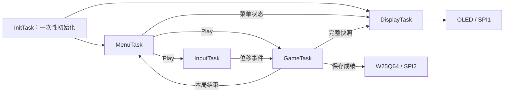

<p align="center">
  
</p>

<h1 align="center">OptiDodge</h1>

<p align="center"><strong>滑动设备，躲避弹幕，也把嵌入式系统一步步搭起来。</strong></p>
<p align="center">STM32F103C8T6 · 128 × 64 单色 OLED · PAW3327 光学位移 · W25Q64 · FreeRTOS</p>
<p align="center"><a href="README.md">English</a> · <strong>简体中文</strong></p>

> **开发快照：2026-10-28。** 项目已具备硬件验证程序与多个应用模块，完整 RTOS 游戏仍在接入。当前固件上电进入的是 **W25Q64 JEDEC ID 检测程序**，还不会直接启动完整游戏或下图中的菜单。


*图片根据 Git 内的菜单代码和点阵字库，在逻辑 128 × 64 像素空间中重建。设置、分数为示例状态；图片不是实机截图，也未模拟具体控制器的列偏移。*

**快速阅读：** [当前进度](#当前进度) · [硬件](#硬件) · [构建与运行](#构建与运行) · [操作与菜单](#操作与菜单) · [软件架构](#软件架构) · [后续计划](#后续计划)

## 项目介绍

OptiDodge 是基于 STM32F103C8T6 的单色 OLED 弹幕躲避游戏项目。目标操作方式是**在桌面上平移设备**：PAW3327 光学传感器测得相对位移，转换为玩家移动，躲避从四周进入画面的球形障碍；四个按键负责菜单与参数设置。

仓库同时包含 STM32 HAL 固件、绘图与游戏算法、排行榜和设置存储模块、FreeRTOS 接入框架，以及 PCB、原理图、BOM 和外壳设计。开发按模块推进：先验证显示与存储，再接通输入、游戏状态、绘图和任务调度。

## 当前进度

需要区分**模块已经写出**、**当前入口实际运行的内容**和**尚未接通的完整功能**：

| 模块 | 仓库中已有的内容 | 当前接入情况 |
|---|---|---|
| OLED | HAL 阻塞式 SPI 驱动、初始化、清屏、字符、数字、位图与字体切换 | 当前检测程序使用该驱动；已进行实机点亮与显示验证 |
| 绘图 | 5 × 5 玩家标记、可调直径圆形、页式帧缓冲图元合成 | 绘图接口已实现，尚未连接完整游戏绘制循环 |
| 菜单 | 主菜单、设置、排行榜、选中箭头和翻页 | 已有模块代码；提交 `431931f` 记录了 PCB 上的菜单测试，当前 `main()` 仍运行检测程序 |
| W25Q64 | JEDEC ID、读取、写使能、页编程、扇区擦除和忙查询 | 当前启动示例读取 ID；通信错误和超时处理仍需完善 |
| 排行榜 | 最多 100 条分数、降序堆排序、二分插入、加载/保存/清空 API | 已有模块实现；存储格式和可靠性还需修正、验证 |
| 设置 | 球大小、难度、DPI 选项、默认值和 Flash 读写 API | 可修改 RAM 设置；选择 DPI 尚不等于已经配置传感器寄存器 |
| 游戏逻辑 | 玩家/球结构体、四边生成、整数速度、相对运动碰撞原型 | 尚未把玩家移动、弹幕更新与结束流程接成完整主循环 |
| 光学输入 | 已分配 PAW3327 片选和 MOTION 引脚 | Git 中尚无 PAW3327 寄存器/位移读取驱动 |
| FreeRTOS | V10.5.1 内核、Cortex-M3 RVDS 移植层、`heap_4`、`RTOS_Init()` 和 `InitTask()` 框架 | `main()` 未调用 `RTOS_Init()`；`InitTask()` 暂未创建应用任务 |
| 硬件设计 | 原理图、PCB、BOM、外壳 CAD 与 STL | 已收录设计源文件，装配时需要核对实物与设计版本 |

## 硬件

### 平台与当前总线配置

| 项目 | 当前配置 |
|---|---|
| 主控 | STM32F103C8T6 / Cortex-M3；目标内存范围为 64 KiB Flash、20 KiB SRAM |
| 固件时钟 | 当前 `SystemClock_Config()` 使用 **8 MHz HSI，不启用 PLL**；芯片支持 72 MHz 不代表当前程序已运行在 72 MHz |
| OLED | 128 × 64 单色六针串行模块：VCC/GND/SCL/SDA/RST/D/C |
| SPI1 / OLED | 主机、8 位、MSB 先发、**Mode 3**、8 分频；按当前时钟约 **1 MHz** |
| SPI2 / 存储及预留传感器 | 主机、8 位、MSB 先发、**Mode 0**、2 分频；按当前时钟约 **4 MHz** |
| HAL 时基 | TIM2 提供 HAL tick；SysTick 留给 FreeRTOS 接入 |
| 下载与调试 | 保留 SWD，关闭 JTAG 以释放按键占用引脚 |

接线以 [main.h](OptiDodge/Core/Inc/main.h)、[main.c](OptiDodge/Core/Src/main.c) 中的初始化和 [引脚分配表](OptiDodge_pin.csv) 为准。厂商 OLED 文件开头保留的历史接线注释，不是当前有效引脚分配。

### 信号连接

| 连接 | STM32 引脚 | 用途 |
|---|---|---|
| OLED SCL / SCK | PA5 | SPI1 时钟 |
| OLED SDA / DIN | PA7 | SPI1 MOSI |
| OLED RST | PA2 | 屏幕复位控制 |
| OLED D/C | PA3 | 命令/数据选择 |
| OLED VCC / GND | 3.3 V / 共地 | 对应已验证的屏幕供电接法 |
| 共享 SPI2 SCK | PB13 | W25Q64 总线时钟；预留光学输入总线 |
| 共享 SPI2 MISO | PB14 | 主控接收 |
| 共享 SPI2 MOSI | PB15 | 主控发送 |
| W25Q64 NCS | PA9 | 低电平片选 |
| PAW3327 NCS | PA8 | 已预留，传感器驱动待接入 |
| PAW3327 MOTION | PA10 | 当前为 GPIO 输入，尚无 EXTI 处理流程 |
| KEY1 / KEY2 / KEY3 / KEY4 | PB3 / PB4 / PB5 / PB6 | 上拉输入，按下为低电平 |
| SWDIO / SWCLK | PA13 / PA14 | 保留下载与调试 |

六针 OLED 没有引出 CS，本移植中对应宏为空操作。SPI1 专供 OLED 使用；W25Q64 和预留传感器共用 SPI2。两个 SPI2 片选在初始化时均置高，`W25Q64_Enable()` 先取消传感器片选，再选中 Flash。传感器供电和连接应以实际 PCB 版本为准，上表只是逻辑信号分配，不是裸芯片电气规格。

硬件设计文件：

- [嘉立创 EDA 专业版工程](<PCB%20And%20Shell/OptiDodge_PCB/Ball_Gaming_PCB.eprj3>)、[原理图](<PCB%20And%20Shell/OptiDodge_PCB/sch/Schematic1/P1.esch2>)、[PCB](<PCB%20And%20Shell/OptiDodge_PCB/pcb/PCB1.epcb2>)。
- [BOM 表](<PCB%20And%20Shell/OptiDodge_PCB/BOM_Board1_PCB1_2026-10-20.xlsx>)。
- [外壳 STL](<PCB%20And%20Shell/OptiDodge.STL>)、[SolidWorks 源文件](<PCB%20And%20Shell/OptiDodge.SLDPRT>)。
- [EDA 文件夹化工程格式说明](<PCB%20And%20Shell/OptiDodge_PCB/eprj3-intro.md>)。

## 构建与运行

### 主要开发环境

- Keil MDK-ARM / µVision，工程选用 **ARM Compiler 5.06 update 5，build 528**。
- 工程目标：**OptiDodge**；芯片：**STM32F103C8**。
- 工程记录的器件包为 **Keil.STM32F1xx_DFP.2.2.0**；Git 内 CubeMX 配置记录 **STM32Cube FW_F1 V1.8.7**。
- [Keil 工程](OptiDodge/MDK-ARM/OptiDodge.uvprojx)、[CubeMX 配置](OptiDodge/OptiDodge.ioc)。

**全新检出的构建限制：**当前 Keil 工程仍引用本地生成/器件支持环境提供的 ARMASM 启动项，Git 内尚未交付完整的 MDK 启动文件集合。首次在新环境构建前，需要通过仓库内 CubeMX 配置或匹配的器件包补齐 MDK 器件支持。[已跟踪的 GNU 启动文件](OptiDodge/startup_stm32f103xb.s) 使用另一种汇编语法，不能直接替代 ARMASM 启动项。建议先在单独工作副本中重新生成，保留应用模块的接入配置。

仓库也有 [CMake 配置](OptiDodge/CMakeLists.txt)，但当前 Git 文件集尚不能独立完成其声明的 GCC 构建。已使用的主要开发路线为 Keil；本文不声称已经验证“全新克隆即可完成 GCC 构建”。

### 首次验证流程

1. 按引脚表接好实际 PCB、OLED 和 W25Q64，保留 SWD 连接。
2. 打开 Keil 工程，选择对应编译器与器件支持，编译 **OptiDodge** 目标。
3. 在 **Options for Target → Debug → ST-Link Settings → Flash Download** 中启用 **Reset and Run**，让下载完成后自动启动程序；复位方式需要与下载器及 NRST 接线匹配。
4. 下载固件，退出暂停的调试状态，让程序运行。
5. 当前循环显示 `MID:`、`DID:` 和递增的 `RUN:`，每轮末尾进行 500 ms HAL 延时。ID 来自真实 Flash 读取，并不是写死的显示字符串。

正常启动显示的是存储检测界面。要运行菜单，需要把已有菜单函数接入应用流程；菜单模块中选择 Play，也不会自动生成尚未完成的游戏任务。

### 已遇到的调试问题

| 现象 | 优先检查 |
|---|---|
| 下载后画面停留，按开发板 RST 才恢复 | 检查 **Reset and Run** 和下载器复位配置，再排查 OLED 协议 |
| 必须反复按 F5 程序才往下跑 | 取消循环中的断点，再按一次 F5 连续运行 |
| 屏幕一直全亮 | `0xA5` 会强制全亮；发送 `0xA4` 恢复显存显示 |
| 初始化后仍为黑屏 | 初始化会清空显存，需要写入显示内容或有意执行全亮测试 |
| Flash ID 明显异常 | 检查 SPI2 接线、片选默认高电平、供电与焊接；最近硬件测试提交记录过 GPIO 默认电平及补焊修复 |

## 操作与菜单

当前 [按键驱动](OptiDodge/Hardware/Key.c) 采用 20 ms 消抖，**松开按键后**才返回一次事件。驱动内部把 `vTaskDelay` 名称临时映射到了 `HAL_Delay`，目前仍属于阻塞式硬件验证写法。

| 按键 | 返回事件 | 菜单用途 |
|---|---|---|
| KEY1 / PB3 | Down | 下一项 / 排行榜下一页 |
| KEY2 / PB4 | Up | 上一项 / 排行榜上一页 |
| KEY3 / PB5 | Right | 确认；增大设置值；执行恢复默认/清空分数 |
| KEY4 / PB6 | Left | 从排行榜返回；减小可调参数 |

[Menu.c](OptiDodge/Interface/Menu.c) 中各页面的实际行为：

- **主菜单：**顺序为 Play → Setting → Ranking，上下循环选择。确认 Play 后切换页面，并向调用者返回 `GaTrue`。
- **设置：**上下选择 Ball Size、Game Diff、DPI、Restore、Clear Score；在第一项继续向上或最后一项继续向下，会返回主菜单。左右修改参数，右键执行两个操作项。目前清空分数没有二次确认框。
- **排行榜：**每页 4 条，当前按 100 条容量固定分为 25 页；即使有效成绩较少也不会缩减页数。左键返回主菜单。
- **游戏页：**已有页面枚举，完整游戏画面及输入/游戏任务的交接仍需实现。

`Menu_Task(void)` 是返回 `CreateGame` 的轮询辅助函数，**不是 FreeRTOS 任务入口函数**。当前菜单函数会直接操作 OLED；让绘图任务统一拥有 OLED，属于后续重构目标。

### 现有设置项

| 设置 | 默认值 | 范围/选项 | 当前作用 |
|---|---:|---|---|
| 球直径 | 7 像素 | 菜单限制为 3–20 像素 | 重新生成圆形点阵 |
| 难度 | 1 | 1–5 | 修改设置结构体；与完整游戏规则的映射待接入 |
| DPI | 1200 | 800 / 1200 / 2400 / 4800 | 修改存储值，尚未写入传感器寄存器 |
| 恢复默认 | — | 右键执行 | 把默认设置复制到 RAM；持久化是独立 API 操作 |
| 清空分数 | — | 右键执行 | 清空 RAM 排行榜并擦除成绩所在扇区 |

存在 `Save_Setting()` 并不表示每次调参都会自动保存。启动加载、保存时机，以及恢复默认后向各相关模块应用参数，仍需完成整合。

## 绘图与游戏数据


*这是绘图图元的静态组合示例：玩家使用真实的 5 × 5 十字点阵，九个圆按当前 Bresenham 公式生成。位置为演示值，不是运行中的游戏截图。*

[Draw.c](OptiDodge/System/Draw.c) 生成空心圆点阵，再通过按位或将图元合成到页式缓冲区。[Pattern.h](OptiDodge/System/Pattern.h) 定义了 128 × 64 屏幕、5 × 5 玩家和最多 20 个球的对象池容量。

单色屏的存储规则：

```text
帧缓冲大小 = 128 × 64 / 8 = 1024 字节
字节下标   = (像素 y / 8) × 128 + 像素 x
字节内位号 = 像素 y % 8
```

当前源码中的接口约定：

- `draw_Player(canvas, x, y)` 接收**玩家中心坐标**；`draw_Ball(canvas, x, y)` 接收**球点阵左上角坐标**。
- 文字函数和 `OLED_Set_Pos()` 的 y 参数是**页号**，不是像素行号。小字体分支还会额外写到 `y + 1` 页。
- `Set_Font_size(SMALL)` 选择 6 × 8 字体；`Set_Font_size(LARGE)` 选择 8 × 16 字体。
- **当前 `OLED_DrawBMP()` 使用包含终点的循环。** 1024 字节全屏缓冲对应 `OLED_DrawBMP(0, 0, 127, 7, canvas)`。这与早期不包含终点的例程不同，不要向当前实现传入 128、8。
- `OLED_Set_Pos()` 仍保留 `(x & 0x0F) | 0x01` 的旧列地址写法；需要先验证控制器对齐，才能把逻辑预览位置当作实际屏幕像素测量值。

外设和 OLED 初始化完成后的图元合成示例：

```c
static unsigned char canvas[1024];

memset(canvas, 0, sizeof(canvas));
Set_Ball_D(7);
draw_Player(canvas, 64, 32);
draw_Ball(canvas, 20, 24);
OLED_DrawBMP(0, 0, 127, 7, canvas);
```

[Game.c](OptiDodge/System/Game.c) 已定义玩家位置与位移、球的有符号坐标、x/y 速度、活动标志、20 球对象池及 32 位分数。这些类型目前放在该 `.c` 文件内部。速度字段注释约定未来一个游戏时间步为 **40 ms / 25 Hz**；这是当前建模约定，不是实测帧率。

游戏模块已有四边生成、速度模长为每步 2–5 像素的整数速度表，以及基于相对运动的碰撞原型。碰撞函数考虑起点、终点和运动线段最近点；坐标锚点、有效碰撞半径与数值/边界情况仍需验证，不能据此声称完整碰撞系统已经验收。

## 存储布局

当前实现是**设置与成绩分别使用一个扇区**，不是具有事务提交能力的 A/B 双快照。

| 区域 | 起始地址 | 当前格式 |
|---|---|---|
| 设置 | `0x000000` | +0：1 字节球大小；+1：1 字节难度；+2：2 字节 DPI |
| 排行榜 | `0x001000` | 4 字节数量槽，之后最多 100 × 4 字节分数 |

对应实现：[W25Q64.c](OptiDodge/Hardware/W25Q64.c)、[Score.c](OptiDodge/System/Score.c)、[Setting.c](OptiDodge/System/Setting.c)。

分数通过最小堆排序得到降序结果，二分查找确定插入位置，同分新记录放在已有记录之后。榜单满时，新分数必须超过末位才会插入。`Insert_Score()` 只修改 RAM，写入 Flash 需要单独调用保存接口。

**目前还不能把这些 API 当作可靠持久化的保证：**`Score_Count` 是 1 字节变量，但现有加载/保存调用通过其地址传输 4 字节，必须先修正这个宽度不匹配。驱动还需要完善页边界拆分、超时/通信错误返回、空白或损坏设置校验，以及断电提交与恢复流程。当前没有实现 CRC、格式版本或冗余快照。

## 软件架构

### 当前执行流程

```text
HAL_Init → 时钟/GPIO/SPI 初始化 → OLED 复位与初始化
    → 循环：读取 W25Q64 JEDEC ID → 显示 MID/DID/RUN → HAL_Delay(500)
```

菜单、游戏、设置与排行榜模块目前位于这条硬件验证主循环之外。加入内核源码，并不等于已经启动调度器或运行五任务方案。

### 后续五任务方向

| 任务 | 负责内容 | 唤醒/退出方式 |
|---|---|---|
| InitTask | 先创建队列、同步资源，再创建菜单与显示任务 | 只运行一次，完成后删除；每局结束不重新创建 |
| MenuTask | 管理菜单、设置、排行榜页面状态，请求启动游戏 | 等待输入；选择 Play 后完成交接 |
| InputTask | 读取 PAW3327 相对位移，提交输入；初期目标为 5 ms 轮询 | 周期阻塞等待；退出游戏时正确停止/清理本局输入 |
| GameTask | 统一修改当前游戏数据：玩家边界、弹幕、碰撞、分数和结束状态 | 固定时间步更新；保存记录后返回菜单 |
| DisplayTask | 统一操作 OLED，读取完整快照绘制菜单/游戏画面 | 等待帧周期或事件，不持续占用 CPU |



这是前面讨论的开发方向，不是当前正在运行的任务图。输入通过队列传递，快照只在短时间复制时保护；绘图与 SPI 传输不应长期占用游戏状态锁。传感器读取和 Flash 写入并发后，SPI2 还需要独立的总线协调。各任务的最终优先级和栈大小尚待分配、实测。

现有框架仅创建 `InitTask`：优先级 1，栈深度 128 个 word，随后启动调度器。任务体尚未创建其他任务，直接删除自身。[FreeRTOSConfig.h](OptiDodge/Core/Inc/FreeRTOSConfig.h) 配置为 1 kHz tick、5 个优先级、17 KiB heap，并启用软件定时器。**其中 CPU 时钟仍写为 72 MHz，而 `main.c` 实际运行在 8 MHz。** 正式接通任务前，需要统一时钟配置，核算 20 KiB SRAM 内的堆、栈、队列和画布占用，并替换按键驱动中的 HAL 延时临时映射。

## 仓库目录

```text
.
├── README.md / README_ZH.md        中英文说明
├── assets/readme/                 纳入 Git 的图标、预览图与生成脚本
├── OptiDodge_pin.csv               引脚分配
├── OptiDodge/
│   ├── Core/                      入口、时钟、GPIO、中断与 HAL 时基
│   ├── Hardware/                  OLED、按键、W25Q64 驱动
│   ├── Interface/                 菜单页面与导航
│   ├── System/                    绘图、游戏、排行榜、设置、RTOS 框架
│   ├── FreeRTOS/                  内核、RVDS Cortex-M3 移植层与 heap_4
│   ├── Drivers/                   STM32 HAL 与 CMSIS
│   ├── MDK-ARM/                    Keil 工程定义
│   ├── cmake/                     CMake/工具链框架
│   └── OptiDodge.ioc               CubeMX 配置
└── PCB And Shell/                 PCB、原理图、BOM、外壳设计源文件
```

本文只引用 Git 已跟踪的项目资料与本次新增的文档配图；阅读文档不依赖本机编译产物或其他本地参考资料集合。

## 后续计划

- [x] 验证 OLED 文字/位图输出与 W25Q64 ID 通信。
- [x] 实现绘图图元、菜单页面、设置 API、排行榜排序与弹幕生成辅助函数。
- [ ] 接入并验证 PAW3327 位移读取、轴向映射和灵敏度缩放。
- [ ] 完成玩家边界、弹幕移动/回收、碰撞、计时及游戏结束流程。
- [ ] 接通五任务模型，统一时钟，用阻塞机制协调输入/显示，测量栈与堆占用。
- [ ] 完善存储：修正数量宽度、校验设置、返回错误、处理页边界，并设计断电恢复格式。
- [ ] 补齐全新检出的构建链，再进行实机帧率、输入延迟和长时间稳定性测试。

## 文档配图与来源

两张像素预览图可用 Python 3 和 Pillow 重新生成：

```sh
python -m pip install pillow
python assets/readme/render_previews.py
```

[预览生成脚本](assets/readme/render_previews.py) 读取 Git 内字库、菜单文字、玩家点阵和默认参数，无需本机 HTML 预览页或开发板。项目图标使用内置 imagegen 工具生成，[生成提示词](assets/readme/icon-prompt.txt) 随仓库提供。图标属于项目标识，图中的标记不代表当前固件的玩家点阵。

OLED 代码保留中景园电子原始作者声明。STM32 HAL、CMSIS 等组件保留各自许可，见 [HAL 许可](OptiDodge/Drivers/STM32F1xx_HAL_Driver/LICENSE.txt)、[CMSIS 许可](OptiDodge/Drivers/CMSIS/LICENSE.txt)、[器件支持许可](OptiDodge/Drivers/CMSIS/Device/ST/STM32F1xx/LICENSE.txt)。FreeRTOS 内核源文件带有对应许可声明。目前仓库未声明统一的项目许可证，不能用某个第三方组件的许可代替整个应用或硬件设计的授权。

---

[Read this README in English →](README.md)
