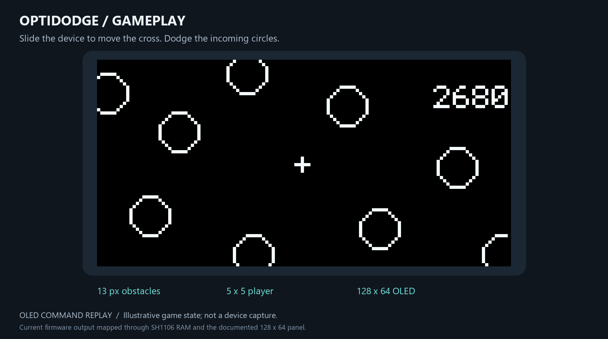
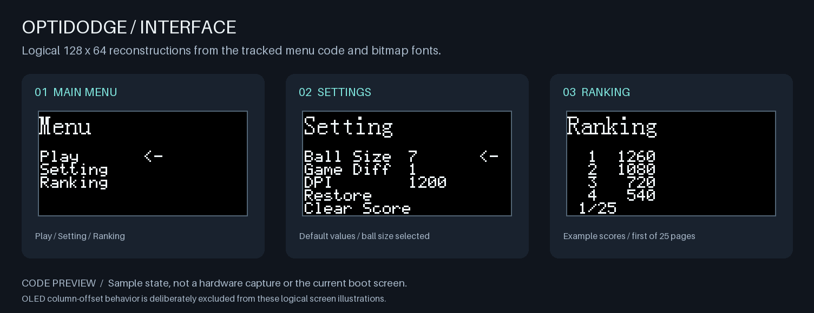
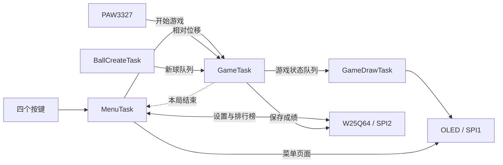

  

<h1 align="center">OptiDodge</h1>

<strong>滑动设备，躲避迎面而来的小球。</strong>

STM32F103C8T6 · FreeRTOS · PAW3327 · 单色 OLED

<a href="README.md">English</a> · <strong>简体中文</strong>

## 项目介绍

OptiDodge 是一款基于 STM32 的桌面弹幕躲避小游戏。在桌面上滑动设备，便能控制 128 × 64 OLED 上的十字形玩家。圆形障碍物从屏幕边缘进入，玩家通过躲避它们持续积累分数。

项目结合了光学位移检测、嵌入式绘图、FreeRTOS 多任务协作和 Flash 数据存储，并配有自制 PCB 与 3D 打印底板。

*运行当前绘图与 OLED 函数，按仓库手册中的 SH1106 显存及面板映射重建游戏画面，包含页地址与列地址偏移。位置和成绩为示例；这是写完一帧后的显示模拟，非实机截图。*

## 功能与操作

- **Play：**开始游戏，滑动设备躲避小球；发生碰撞后结束本局，并进入成绩记录流程。
- **Ranking：**按分数从高到低浏览排行榜，最多存储 100 条记录。
- **Setting：**调整小球尺寸和移动灵敏度，恢复默认设置或清空分数。
- **Game Over：**显示本局结束提示，随后返回主菜单。

四个按键负责界面操作：

| 输入 | 作用 |
|---|---|
| 滑动设备 | 游戏中移动玩家 |
| 上 / 下 | 切换菜单选项或排行榜页码 |
| 右 | 确认选项、增大参数或执行操作 |
| 左 | 减小参数；从排行榜返回 |

在设置页，从第一项继续向上或从最后一项继续向下，可返回主菜单。DPI 设置用于软件移动灵敏度缩放，传感器初始化时固定为 1500 CPI。菜单保留了难度选项，当前尚未将其映射到小球生成或速度规则。

*根据源码重建的界面示意。图中的参数和成绩为示例，不代表当前默认值，也不是实机截图。*

## 软件架构

游戏状态更新与绘图分开执行：游戏任务读取传感器、更新坐标并检测碰撞，绘图任务接收一份游戏状态副本，将其绘制到屏幕。

| 任务 | 职责 |
|---|---|
| InitTask | 加载设置，创建队列和事件组，启动菜单后删除自身 |
| MenuTask | 处理菜单、设置和排行榜；选择 Play 后创建游戏相关任务 |
| GameTask | 读取光学位移、进行灵敏度缩放，更新小球和玩家，检测碰撞并更新分数 |
| BallCreateTask | 使用随机周期的单次定时器生成小球，通过队列发送给游戏任务 |
| GameDrawTask | 将玩家和小球合成到画布，刷新 OLED，并显示 Game Over |

这五个任务函数并非全程同时运行：进入游戏后，菜单将控制权交给游戏相关任务；本局结束后重新创建菜单任务。菜单页面由 MenuTask 绘制，游戏画面由 GameDrawTask 绘制，游戏相关任务通过事件组协调退出。

游戏定时器每 **40 ms** 请求一次更新。绘图使用 **1024 字节的单色帧缓冲**、Bresenham 圆形绘制算法，以及最多容纳 **20 个小球**的对象池。碰撞检测基于一帧内的相对运动，检查起点、终点和运动途中的最近距离。

## 技术栈

| 层次 | 使用的技术 |
|---|---|
| 主控 | STM32F103C8T6，Arm Cortex-M3，64 KiB Flash / 20 KiB SRAM |
| 固件 | C、STM32 HAL、CMSIS |
| 任务调度 | FreeRTOS V10.5.1，任务、队列、任务通知、软件定时器和事件组 |
| 显示 | 128 × 64 单色 OLED，位图合成，6 × 8 / 8 × 16 字体 |
| 输入 | PAW3327 光学位移传感器、四个轻触按键 |
| 存储 | W25Q64 SPI NOR Flash，保存设置和成绩 |
| 开发工具 | Keil MDK-ARM / ARM Compiler 5、STM32CubeMX、ST-Link / SWD |
| 硬件设计 | 嘉立创 EDA 专业版设计 PCB，SolidWorks 设计底板，STL 用于 3D 打印 |

当前时钟配置为 **8 MHz HSE 经 PLL 九倍频得到 72 MHz**。SPI1 和 SPI2 均采用 **Mode 3，时钟约 1.125 MHz**。OLED 独占 SPI1；传感器和 Flash 共用 SPI2，使用独立片选。

## 硬件与物料

下面结合项目 PCB BOM 与实际采购规格整理。能确定的数量按单台设备列出，整包采购数量不等于单台用量。

### 主要元件

| 元件 | 规格 | 数量 | 用途 |
|---|---|---:|---|
| STM32 核心板 | 立创地阔星 LCKFB-DKX-STM32F103C8T6 | 1 块 | 主控 |
| 光学传感器套件 | PAW3327DB-TWQU，DIP-8，含透镜和照明 LED | 1 套 | 检测设备相对桌面的移动 |
| OLED 模块 | 1.3 英寸，128 × 64，白色单色显示，六针 SPI | 1 块 | 显示菜单与游戏画面 |
| Flash 芯片 | W25Q64JVSSIQ，SOP-8，64 Mbit / 8 MiB | 1 颗 | 保存设置和成绩 |
| 电源模块 | 5 V / 3.3 V 电源模块，配 14500 锂电池 | 1 套 | 为整机供电 |
| 轻触开关 | TS-1088-AR02016，约 4 × 3 mm | 4 颗 | 菜单操作 |

传感器套件已包含透镜和照明 LED。PCB BOM 的照明位置标注为 HSDL-4261，装配时需核对套件 LED 与封装。采购选型为 W25Q64JVSSIQ，设计 BOM 中标注的是 W25Q64JVSSIM。

### 阻容与装配材料

| 物料 | 规格 | 数量 / 装配说明 |
|---|---|---|
| 电阻 | 0603，10 kΩ，1% | 4 颗 |
| 电阻 | 0603，33 Ω，1% | 1 颗 |
| 电容 | 0603，100 nF，±10%，50 V | 3 颗 |
| 电容 | 0603，10 µF，±10%，10 V | 2 颗 |
| 指示 LED | 0603，PCB BOM 型号为 GL0603UR01 | 1 颗 |
| 排母 | 6P 单排、20P 单排、2 × 2 双排 | 按 OLED、核心板和电源连接位置配置 |
| 螺丝 | M3 × 3，不锈钢 | 按安装孔位配置 |
| 铜柱 | M3 × 4，双通六角铜柱 | 按安装孔位配置 |
| 鼠标脚贴 | PTFE 圆点，直径 6.5 mm，厚度 0.8 mm | 安装于底板，支撑设备平稳滑动 |

自制 PCB 和打印底板属于另外制作的结构件。排母、紧固件的数量以实际装配为准。核心板与指示 LED 根据设计 BOM 列出，其余规格结合采购记录补充。

### 外设连接

| 外设 | STM32 信号 |
|---|---|
| OLED / SPI1 | SCK PA5、MOSI PA7、RST PA2、D/C PA3 |
| 共用 SPI2 | SCK PB13、MISO PB14、MOSI PB15 |
| PAW3327 | NCS PA8、MOTION PA10 |
| W25Q64 | NCS PA9 |
| 按键 | KEY1～KEY4：PB3、PB4、PB5、PB6 |
| SWD | SWDIO PA13、SWCLK PA14 |

六针 OLED 没有引出 CS。当前由 GameTask 轮询读取传感器位移；PCB 已连接 MOTION，但游戏输入尚未使用该引脚触发。完整分配见[引脚表](OptiDodge_pin.csv)。

## 源码与设计文件

| 位置 | 内容 |
|---|---|
| [Core](OptiDodge/Core) | 应用入口、时钟、GPIO 与中断处理 |
| [Hardware](OptiDodge/Hardware) | OLED、PAW3327、W25Q64 和按键驱动 |
| [Interface](OptiDodge/Interface) | 主菜单、设置和排行榜页面 |
| [System](OptiDodge/System) | 游戏逻辑、绘图、存储模块和 RTOS 任务 |
| [FreeRTOS](OptiDodge/FreeRTOS) | RTOS 内核与移植层 |
| [Keil 工程](OptiDodge/MDK-ARM/OptiDodge.uvprojx) · [CubeMX 配置](OptiDodge/OptiDodge.ioc) | 固件工程配置 |
| [PCB 工程](<PCB%20And%20Shell/OptiDodge_PCB/Ball_Gaming_PCB.eprj3>) · [PCB BOM](<PCB%20And%20Shell/OptiDodge_PCB/BOM_Board1_PCB1_2026-10-20.xlsx>) | 电路板设计与元件清单 |
| [SolidWorks 模型](<PCB%20And%20Shell/OptiDodge.SLDPRT>) · [STL](<PCB%20And%20Shell/OptiDodge.STL>) | 底板 / 外壳设计 |

本项目是持续完善中的课程实践项目。第三方驱动与库保留各自的作者和许可声明。

---

[Read this README in English →](README.md)
